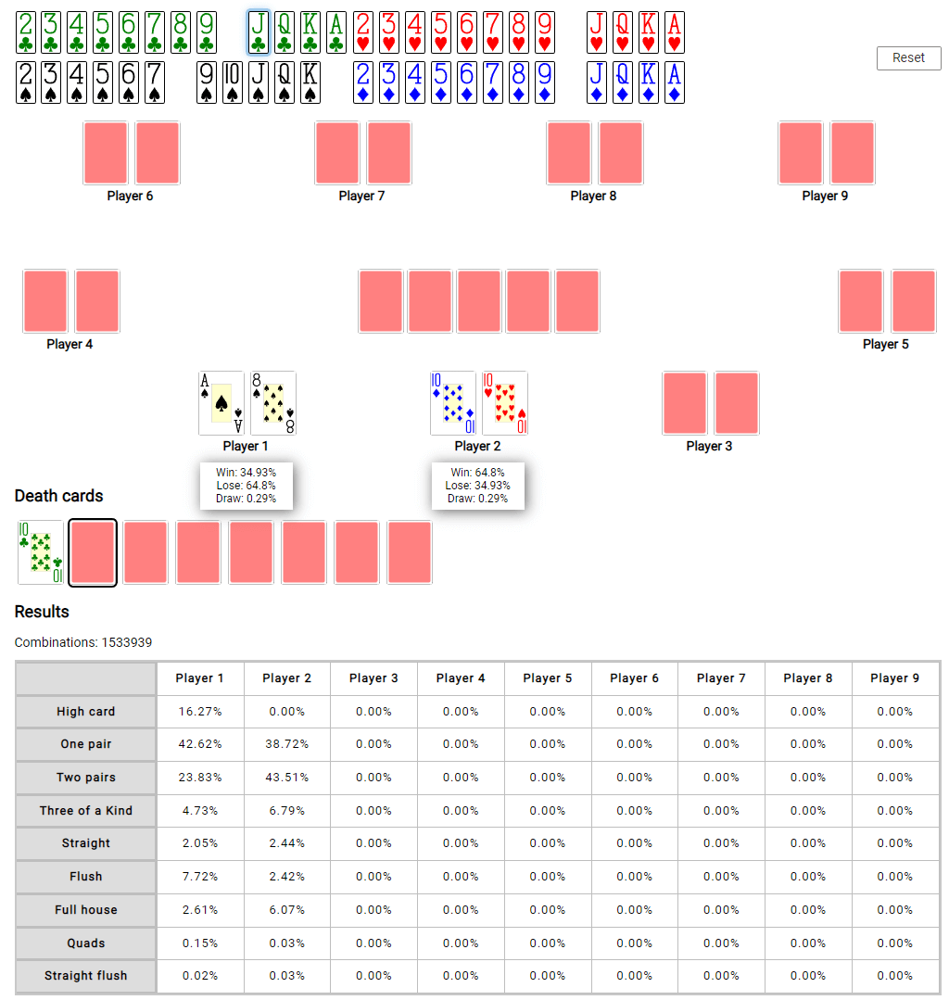

# Poker Master Tool

Open-source poker hand calculator.

## Table of contents

- [General info](#general-info)
- [Architecture](#architecture)
- [Features](#features)
- [Quick start with Docker](#quick-start-with-docker)
- [Installation](#installation)
- [Unit and performance tests](#unit-and-performance-tests)
- [Development](#development)
- [License](#license)

## General info

This project has been written to a develop fast open-source hand calculator for Texas Hold'em as an Engineering Thesis. It uses TwoPlusTwo evaluator for calculating hand ranks. The repository contains unit and performance tests, Docker image with Docker Compose for quick start and configured CI/CD with GitHub Actions.



## Architecture

The repository is a pnpm workspace with 3 packages:

```
apps/
  backend/     @poker-master-tool/backend  - Express API in TypeScript
  frontend/    @poker-master-tool/frontend - SvelteKit (Svelte 5) app in TypeScript
packages/
  addon/       @poker-master-tool/addon    - C++ calculator, lookup table generator and benchmark
e2e/           Playwright end-to-end test
docs/          Images for this README
```

- The backend uses the addon as the workspace dependency `@poker-master-tool/addon`.
- The frontend build writes static files to `apps/frontend/build`. The backend serves them. To use a different directory, set the `STATIC_DIRECTORY` environment variable.
- The addon reads the lookup table from `packages/addon/data/HandRanks.dat`.

## Features

- Responsive web application for Poker Texas Hold'em odds calculator up to 9 players
- Displaying the number of enumerated combinations and hand rank probability for each player
- Support for Death Cards
- Request caching on the backend side
- Logging requests with log retention politics stored inside the `apps/backend/logs` directory

## Quick start with Docker

Turn on Docker and in your terminal run:

```bash
docker-compose up
```

App will be listening on `http://localhost:3000`.

The image contains only the built backend, its production dependencies, the addon with the lookup table and the static frontend.

## Installation

To install the application, you need Node 26, pnpm 10, make and a g++ compiler.

Next, follow consecutive commands. `pnpm install` also builds the addon, and `pnpm build` builds the addon, the backend and the frontend:

```bash
pnpm install

pnpm generate-table

pnpm build

pnpm start
```

The app will be listening on `http://localhost:3000`.

## Unit and performance tests

Unit tests use the Node.js test runner (`node:test`).

To run unit tests run:

```bash
pnpm test
```

if you wish to get a coverage report you run `pnpm test:coverage`.

The end-to-end test uses Playwright. It builds the application, starts the backend and calculates the odds in the browser. Generate the lookup table before you run it:

```bash
pnpm exec playwright install chromium

pnpm test:e2e
```

To run the performance benchmark for the addon, run:

```bash
pnpm test:benchmark
```

The benchmark uses tinybench. It runs each scenario for a minimum of 2 seconds and 64 iterations. It writes the results to the `packages/addon/benchmark/results` directory:

- `tinybench-<timestamp>.md` - a Markdown table with the results.
- `tinybench-<timestamp>.json` - the same results in JSON format.

### Benchmark results

These results are from Node 26.7.0 on an Apple M3 Pro. The full output is in [tinybench-2026-10-16T21-13-31-178Z.md](./packages/addon/benchmark/results/tinybench-2026-10-16T21-13-31-178Z.md) and [tinybench-2026-10-16T21-13-31-178Z.json](./packages/addon/benchmark/results/tinybench-2026-10-16T21-13-31-178Z.json).

Player `n` has the cards `n` and `n + 10`. The community cards and the death cards are the cards 20 to 24. Combinations is the number of boards that the calculator examines.

| Scenario                     | Combinations | Mean (ms) | p99 (ms) | Operations/s |
| ---------------------------- | -----------: | --------: | -------: | -----------: |
| 1 player                     |    2,118,760 |     45.58 |    47.59 |         21.9 |
| 2 players                    |    1,712,304 |     65.22 |    69.35 |         15.3 |
| 3 players                    |    1,370,754 |     55.09 |    57.39 |         18.2 |
| 4 players                    |    1,086,008 |     53.86 |    56.05 |         18.6 |
| 5 players                    |      850,668 |     50.29 |    59.25 |         19.9 |
| 6 players                    |      658,008 |     44.66 |    48.14 |         22.4 |
| 7 players                    |      501,942 |     30.70 |    32.23 |         32.6 |
| 8 players                    |      376,992 |     26.70 |    28.09 |         37.5 |
| 9 players                    |      278,256 |     26.75 |    28.50 |         37.4 |
| 9 players, 1 community card  |       40,920 |     2.848 |    2.985 |        351.3 |
| 9 players, 2 community cards |        4,960 |     0.381 |    0.424 |      2,627.4 |
| 9 players, 3 community cards |          465 |     0.070 |    0.084 |     14,264.1 |
| 9 players, 4 community cards |           30 |     0.035 |    0.045 |     28,621.5 |
| 9 players, 5 community cards |            1 |     0.033 |    0.042 |     31,228.8 |
| 9 players, 1 death card      |      237,336 |     23.88 |    25.12 |         41.9 |
| 9 players, 2 death cards     |      201,376 |     19.99 |    21.50 |         50.0 |
| 9 players, 3 death cards     |      169,911 |     17.33 |    18.39 |         57.8 |
| 9 players, 4 death cards     |      142,506 |     14.59 |    17.56 |         68.8 |
| 9 players, 5 death cards     |      118,755 |     12.09 |    12.82 |         82.7 |

The results change with the hardware and the Node version.

## Development

To serve a frontend by the backend application you should build the frontend first using `pnpm --filter @poker-master-tool/frontend build`. After that you can run the backend development server with the command below. It restarts the backend when you change a file:

```bash
pnpm dev
```

When you work on the frontend, run the Vite development server. It is available on `http://localhost:8080` and sends the `/compute` requests to the backend on port 3000:

```bash
pnpm dev:frontend
```

All packages use the same ESLint, Prettier and TypeScript configuration in the root directory. Versions that more than one package uses are in the `catalog` of `pnpm-workspace.yaml`. To check the code, run:

```bash
pnpm check

pnpm lint

pnpm format:check
```

To format the code, run `pnpm format`.

## License

You can check out the full license [here](./LICENSE)

This project is licensed under the terms of **the MIT license**.
